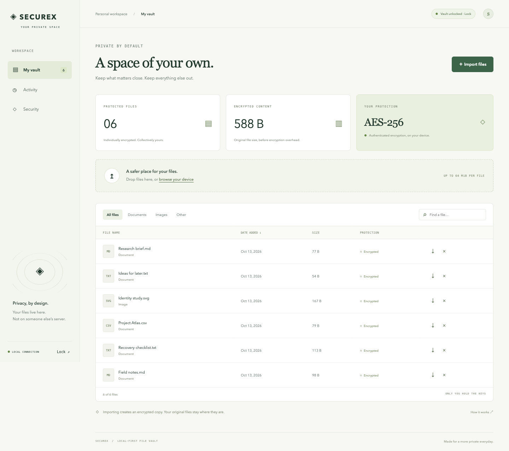

<div align="center">

# ◈ SECUREX

### Your files. Your keys. Your space.

A local-first encrypted file vault with a private browser dashboard and a scriptable CLI.<br>
No account. No cloud service. No outbound connections during normal operation.

[](https://github.com/Shashwat7002/SECUREX/actions/workflows/ci.yml)


[Quick start](#quick-start) · [Security model](docs/SECURITY_MODEL.md) · [Architecture](docs/ARCHITECTURE.md) · [Contributing](CONTRIBUTING.md)

</div>



> **Early release, not independently audited.** SECUREX protects stored files using established cryptographic primitives. It does not guarantee forensic erasure, protect a compromised device, or replace backups. Read the [security model](docs/SECURITY_MODEL.md) before storing sensitive data.

## What works today

- **A complete local dashboard:** create and unlock a vault, drag in files, search and filter your collection, export decrypted copies, remove files, and lock access.
- **Envelope encryption:** AES-256-GCM with a random key per file. Filenames, checksums, timestamps, and file keys live in an encrypted catalog.
- **Passphrase protection:** scrypt with a random 128-bit salt, N=131072, r=8, p=1 wraps a random 256-bit vault key. No password reset service.
- **Integrity checks:** authenticate each file and compare its size and SHA-256 checksum with the authenticated catalog. Missing, altered, and orphaned objects are surfaced.
- **Encrypted backups:** export a consistent snapshot while holding the vault lock; restore it into a separate directory.
- **Access controls:** change your passphrase, manually lock, or let the server drop key references after five minutes without vault activity. Status polling does not keep the vault unlocked.
- **A practical CLI:** initialize, import, list, export, verify, back up, change passphrases, remove files, and remove the wrapped vault key.
- **Engineering foundations:** atomic file replacement, cross-process locking, defensive local HTTP boundaries, automated tests, and Linux/macOS/Windows CI.

## Quick start

Requires **Python 3.11+**. Installation needs internet access to fetch dependencies; running the vault does not.

```bash
git clone https://github.com/Shashwat7002/SECUREX.git
cd SECUREX
python3 -m venv .venv
source .venv/bin/activate
python -m pip install -e .
securex serve
```

On Windows, use `py -m venv .venv` and `.venv\Scripts\Activate.ps1` in PowerShell instead.

The browser opens on `127.0.0.1:8721`. Create a long, unique passphrase and import a file. The default vault directory is `~/.securex/personal.sxvault`. Keep the terminal running; press Ctrl+C to stop the server.

To choose a directory or port:

```bash
securex --vault ./personal.sxvault serve --port 8722
# For environments without automatic browser launch:
securex --vault ./personal.sxvault serve --no-browser
```

The terminal prints a private launch link. Its fragment token is exchanged for an HttpOnly, SameSite=Strict session cookie, then removed from the address bar. A server restart generates new session credentials. Do not share the link or expose the server through a proxy.

### File handling you should know

- Import creates an encrypted copy. **Original files remain untouched.**
- Export creates a decrypted copy in the selected destination or browser downloads.
- Each file is limited to **64 MiB**; a vault supports **10,000 files**. This release encrypts whole files in memory. Streaming large-file support is future work.
- Multiple files with the same name are supported and receive separate opaque IDs.
- The dashboard works offline and loads no external fonts, scripts, analytics, or remote assets.

## Command line

Commands prompt for the passphrase. Secrets are not accepted in command-line arguments or environment variables.

```bash
securex --vault ./personal.sxvault init
securex --vault ./personal.sxvault add report.pdf photo.jpg
securex --vault ./personal.sxvault list
securex --vault ./personal.sxvault export FILE_ID ./restored.pdf
securex --vault ./personal.sxvault verify
securex --vault ./personal.sxvault backup ./securex-backup.zip
securex --vault ./personal.sxvault passwd
securex --vault ./personal.sxvault remove FILE_ID
```

`list` and `verify` emit JSON. `verify` exits with code 1 if any file fails. Export and backup refuse to overwrite an existing destination. Every CLI process drops its in-memory key references when it exits.

### Restore a backup

1. Extract a **trusted SECUREX backup** into a new, empty directory using your OS archive tool.
2. Confirm that `key.json`, `catalog.enc`, and `objects/` are directly inside that directory.
3. Run `securex --vault ./restored.sxvault serve` and unlock using the passphrase that was active **when the backup was made**.
4. Run an integrity check before relying on the restored copy.

An encrypted backup contains wrapped keys. Old backups can restore removed files and remain accessible with their original passphrase. Store and retire them deliberately. Do not restore over a running vault.

### Key removal is not guaranteed erasure

`securex --vault ./personal.sxvault destroy` requires the passphrase and the exact confirmation `DESTROY`. It removes `key.json` and drops this process's key references. The encrypted catalog and objects remain on disk.

Without another copy of the vault key, the remaining ciphertext cannot be decrypted through SECUREX. **Backups, snapshots, SSD remapping, storage remnants, swap, memory, and other unlocked processes may retain usable key material.** The project deliberately does not promise irrecoverable deletion. See [limitations and threat boundaries](docs/SECURITY_MODEL.md).

## How it fits together

```text
Passphrase ── scrypt + random salt ──► wrapping key
                                           │
                                    unwrap vault key
                                           │
                                  decrypt private catalog
                                           │
                               per-file random AES-256 keys
                                           │
                                 authenticated file contents
```

The browser talks only to a local Python service. The same vault engine powers the CLI and dashboard, so their encryption format and integrity checks stay aligned. See [architecture and file format](docs/ARCHITECTURE.md).

## Development

```bash
python -m pip install -e '.[dev]'
ruff check src tests
ruff format --check src tests
pytest -q
python -m build
```

Tests cover round trips, restart recovery, Unicode and empty files, ciphertext and catalog tampering, object substitution, wrong passwords, key rotation, backup restoration, deletion, concurrent writers, failed commits, local HTTP authentication, origin/host controls, idle locking, and CLI workflows.

See [CONTRIBUTING.md](CONTRIBUTING.md) for conventions and [ROADMAP.md](docs/ROADMAP.md) for what is next. Security reports belong in GitHub's private vulnerability reporting flow when enabled; see [SECURITY.md](SECURITY.md).

## License

[MIT](LICENSE). Built by [Shashwat Choudhary](https://github.com/Shashwat7002).
