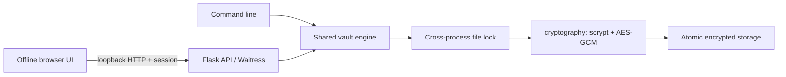

# Architecture and storage format

## Components



`vault.py` owns encryption and storage. `web.py` provides session authorization, origin checks, idle locking, bounded uploads, and API dispatch. `cli.py` owns interactive passphrase prompts and starts the local server. Static HTML, CSS, and JavaScript have no runtime package dependencies or external requests.

## Format v1

```text
personal.sxvault/
├── .lock             # advisory cross-process lock; no secrets
├── key.json          # format, public vault ID, salt, wrapped master key
├── catalog.enc       # encrypted file entries and vault creation time
└── objects/
    └── <32 hex>.enc   # encrypted content, one object per import
```

Each encrypted payload is `12-byte nonce || ciphertext || 16-byte tag`. Every associated-data value starts with `SECUREX/1/`, followed by:

| Purpose | Remaining associated data |
| --- | --- |
| Wrapped master key | `master/<vault-id>` |
| Catalog | `catalog/<vault-id>` |
| File | `file/<vault-id>/<file-id>` |

`key.json` fields: `version` (integer 1), `id` (32 lowercase hex characters), `salt` (base64 16 bytes), `wrapped` (base64 60 bytes), and descriptive `kdf`/`cipher` strings. Version 1 always uses fixed scrypt and AES parameters; user-controlled parameters are never passed through to the KDF.

Catalog plaintext contains `created` (UTC ISO timestamp) and `files`. Each file has `id`, `name`, `size`, `added`, `sha256`, and `key` (base64). API/CLI list responses exclude `key`. The catalog is authenticated before parsing. Original directory paths are not retained.

## Transactions and failure behavior

All vault operations hold a file lock and read the current catalog under that lock; independent unlocked processes cannot overwrite each other's catalog changes with stale copies. File writes create private temporary files in the same directory, flush and fsync, then replace the destination atomically. POSIX directory entries are fsynced after replacement.

Import commits object ciphertext before the catalog. An interrupted import can leave an orphan encrypted object; verification reports its count. Remove commits the catalog without the file key before deleting ciphertext. Failure to delete may leave orphan ciphertext but does not reintroduce the file into the catalog. Backup holds the lock throughout a consistent encrypted snapshot.

This is not a multi-file transactional database. A crash during initial creation can leave a directory without a usable `key.json`; it is not silently overwritten. Individual atomic replacement protects the previous committed catalog during ordinary write failures. Hardware/storage durability and Windows filesystem behavior require platform validation; atomic replacement is not a promise against every power-loss scenario.

## API surface

All paths below use `/api/`. JSON errors have an `error` string. Mutation requests require the exact Origin. Except for session bootstrap, all operations require the session cookie. Locked vault operations return 423.

| Method | Path | Purpose |
| --- | --- | --- |
| POST | session | Exchange launch token for session cookie |
| GET | status | Initialized/unlocked state; does not reset inactivity |
| POST | create, unlock, lock | Vault lifecycle |
| GET / POST | files | List public file metadata / multipart import |
| GET / DELETE | files/{id} | Download plaintext attachment / remove file |
| POST | verify | Authenticate objects and return per-file outcomes |
| GET | events | In-memory, filename-free session activity |
| POST | passphrase | Current/replacement passphrase rotation |
| GET | backup | Consistent encrypted ZIP snapshot |
| POST | destroy | Passphrase and exact DESTROY confirmation |

The session is shared across tabs using the same server. Locking affects all those tabs. Separate server processes hold independent keys and inactivity timers. Supported usage is one dashboard server per vault.
